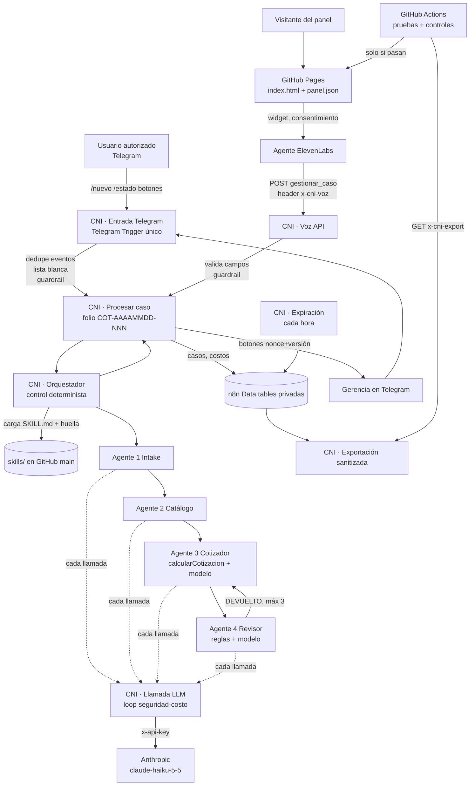

# Arquitectura

## Zonas
| Zona pública | Zona privada |
|---|---|
| HTML, estilos, script, `panel.json` con folio, fecha, canal, estado, versión, líneas, total simulado, tiempo y costo por caso | Tokens, API keys, secretos de webhooks, `chat_id`, seudónimos, solicitudes, clientes, trazas detalladas, aprobaciones, costo y stock del catálogo |
| `agent-id` público de ElevenLabs | Secreto `x-cni-voz` (en ElevenLabs y n8n) |

## Decisiones
- **Orquestador determinista.** El orden del proceso es fijo y auditable. Usar el modelo para enrutar costaría más y agregaría otra fuente de error.
- **Cálculos fuera del modelo.** El Agente 3 usa una herramienta determinista. El modelo solo redacta supuestos, y el servidor rechaza cualquier total que no coincida.
- **Revisor en dos capas.** Primero corren las reglas. Si las reglas ya devolvieron la versión, no se llama al modelo (optimización medida).
- **Una sola puerta al modelo.** El sub-workflow "Llamada LLM" concentra el presupuesto, los reintentos y el registro de tokens. Ningún agente puede saltárselo.
- **Sub-workflows.** No cuentan para la cuota de n8n y mantienen el estado del caso sin depender de referencias entre nodos.
- **Skills cargados en tiempo de ejecución desde `main`.** El texto que se prueba y versiona es el mismo que usa el agente, y la traza guarda versión y huella.
